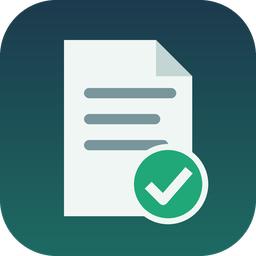

# Stata Workbench Shared Session — 操作 skill



[English](README.md) | [简体中文](README.zh-CN.md) | 繁體中文

給 agent 用的操作 skill：agent 在使用者已有的
[Stata Workbench Shared Session](https://github.com/lzhs1995/stata-workbench-shared-session)
裡執行 Stata，人和 agent 共用同一個可見的 Stata 工作階段。

本版對應 runtime **v0.1.3-rc.7.45**（pre-release）。版本鎖定值、平台結果和 agent 路線寫在
`runtime-compatibility.json` 裡；CI 用這個 tag 的 runtime checkout 檢查 skill。

從 [SKILL.md](skills/stata-workbench-shared-session/SKILL.md) 開始讀。它按使用順序排列：
runtime 是什麼、誰來執行程式碼、macOS 和 Windows 上的三分鐘入門、用戶端的全部選項、Stop、
回執和結束代碼、疑難排解、已知限制和平台說明。references 講分階段工作、回執、保留作者的
`.do` 檔案、儲存、匯出、重新執行和桌面恢復。SKILL.md 只有英文版，內容以它為準。

agent 先看 [AGENTS.md](AGENTS.md)：哪類任務讀哪個檔案。

## 安裝 skill

安裝與 runtime 分開：它不會更新 Workbench、重啟 backend，也不會聯絡別的 agent。

```sh
python3 -B scripts/install.py --prefix /absolute/skill-storage
# 先看它打算做的改動，再執行：
python3 -B scripts/install.py --prefix /absolute/skill-storage --apply
```

安裝器把 skill 和回執檢查腳本複製到 `<prefix>/<skillVersion>/`，再把 Claude、Codex 和
`.agents` 的 skill 路徑指向它。原有路徑保留為帶時間戳記的備份；已有的版本目錄永遠不會被覆蓋。

## 檢查

```sh
python3 -B -m unittest discover -s tests
# 有鎖定 tag 的 runtime checkout 時：
STATA_WORKBENCH_RUNTIME=/abs/runtime python3 -B -m unittest discover -s tests
python3 -B scripts/runtime_contract_check.py --runtime-root /abs/runtime
# 再用發布的 VSIX 核對它的鎖定值：
python3 -B scripts/runtime_contract_check.py --runtime-root /abs/runtime --vsix /abs/stata-workbench-shared-session-0.1.3-rc.7.45.vsix
```

以下情況 `runtime_contract_check.py` 判失敗：SKILL.md、references、任一 README 或 AGENTS.md
提到了鎖定 runtime 沒有的用戶端選項或 `stata-workbench.*` 命令；鎖定值與 checkout 不一致（版本、
tag、bundle、用戶端常數，runtime 目錄是 git checkout 時還有 tag 對應的提交）；什麼都沒檢查到。
`vsixSha256` 只和 `--vsix` 給出的檔案比對。沒能比對的鎖定值列在 `notChecked` 裡。

本存放庫只有操作指南、離線檢查器和合成測試。不要加入研究資料、回執、私人備份或憑證。
